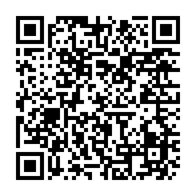

# Rattlegram Plus Plus

<p align="center">
  <a href="https://github.com/doodlecomms/Rattlegram_Plus_Plus/releases/latest/download/RattlegramPlusPlus.apk"></a>
</p>
<p align="center">
  <b>On your phone?</b> Tap the button above. <b>On a computer?</b> Scan this with your phone:<br>
  <a href="https://github.com/doodlecomms/Rattlegram_Plus_Plus/releases/latest/download/RattlegramPlusPlus.apk"></a>
</p>

Short text messages sent as sound — through the phone's speaker and microphone, a cable to a radio, or **wirelessly over Bluetooth to a BTech UV-Pro / Vero VR-N76**. No Wi-Fi or cellular network needed.

Rattlegram Plus Plus is an independent fork of [Rattlegram Plus](https://github.com/BI3BJU/Rattlegram_Plus) by BI3BJU, which itself builds on [Rattlegram](https://github.com/aicodix/rattlegram) by aicodix. It installs **alongside** Rattlegram Plus (it has its own app ID) and uses the same over-the-air format, so messages, pings and encrypted messages (with the same password) should work between the two apps.

| Encrypted message | Encrypted picture | Wipe All Data | Danger Zone |
| :---: | :---: | :---: | :---: |
|  |  |  |  |

## What's new in Plus Plus

- 🔒 **Encrypted messages are marked** *(new in 1.3.1)* — messages that decrypted with your password now say **Received 🔒** (or *Received 🔒 (call sign hidden)*), and the ones you sent encrypted say **Transmitted 🔒**. A plain *Received* always means it came unencrypted, so a station without the password cannot pass a message off as one from your group. Message history, contacts and received pictures are no longer included in phone backups or phone-to-phone transfers.
- 📻 **Rig control with Hamlib** *(new in 1.3, optional)* — Menu → Rig Control (Hamlib) connects a radio on a USB serial (CAT) cable: the app keys it by CAT PTT for every transmission, shows and follows its frequency on the main screen, tunes it (steps, typed frequency, saved frequencies) and can switch it to its data mode while connected. Off by default. Tested on a Yaesu FT-857D with a Digirig Mobile; 275 radio models supported by Hamlib. See *Rig control with Hamlib* below.
- 🕵️ **Hide your call sign** *(new in 1.2)* — Danger Zone → Password → "Hide my call sign in encrypted messages". Encrypted messages, locations, pictures and acknowledgments then go out as **ANONYMOUS**; your call sign travels inside the encryption, so only stations with the password (and 1.2 or newer) see who sent them. Off by default; a "🔒 Call sign hidden" note shows under the Encrypt box while it applies. Amateur bands require station identification, so use it only where that is legal.
- 🧨 **Wipe All Data** *(new in 1.2)* — the red button in the top bar erases everything the app has stored (messages, pictures, locations, password, call sign, contacts, settings) after one confirmation, removes the app from Recent apps and closes it.
- 🔒 **App lock** *(new in 1.2)* — Danger Zone → Lock App on Open. When the app is opened fresh it stays covered until you confirm with the phone's fingerprint, face or screen PIN; screenshots and the Recent apps preview are blocked while it is on. Needs a screen lock on the phone; off by default.
- 🔓 **Unlock later** *(new in 1.2)* — encrypted messages that arrived before you had the right password are decrypted as soon as you enter it, including hidden call signs and locked pictures.
- 🔁 **Safer resend** *(new in 1.2)* — long-pressing a message now asks before sending it again, encrypted when a password is set, and warns when it can only go out unencrypted.
- 🖼️ **Pictures** *(new in 1.1)* — Compose → Picture: take a photo or pick one, choose Small/Medium/Large, optionally Robust and Encrypt. It goes out as a series of ordinary Rattlegram messages with spare parts, so a few lost parts are rebuilt automatically. Photo metadata (GPS location, time, camera) is removed; only the pixels are sent.
- ✅ **Acknowledgments** *(new in 1.1)* — Menu → Acknowledgments: Off, Messages addressed to me (`@CALL ...`), or All messages. The sender's message gets "✓ Acknowledged by …". Your radio transmits the short ACK on its own, so it is off by default.
- 🔐 **Remember password** *(new in 1.1)* — optional; stored encrypted with a key that never leaves the phone and excluded from backups.
- 📍 **Encrypted location sharing** *(new in 1.1)* — the Encrypt box now works for locations too; the map pin is labelled with the sender's call sign.
- 📻 **Bluetooth radio audio** — Menu → Bluetooth Radio connects to a paired **BTech UV-Pro** (and, by the same protocol, **Vero VR-N76**). Receive and transmit go over Bluetooth; the radio keys while it receives audio and is always unkeyed afterwards. No cable or DigiRig.
- 🔇 **Automatic radio speaker mute** — while connected, the radio's speaker is muted and its volume restored on disconnect (also after an unexpected drop).
- 🪖 **SALUTE report** — a form for Size, Activity, Location, Unit, Time, Equipment. Location from GPS as Lat/Long, Maidenhead or MGRS (or typed); time in UTC or local; a live byte counter so the report fits, including in encrypted messages.
- 🔑 **Password by QR code** — show the encryption password as a QR code, scan it on the other phone, or paste it. No more typing 64 random characters.
- ☑️ **Encrypt checkbox remembers** its last setting.
- 🗑️ **Delete Messages on Close** (optional, Danger Zone).
- 🧩 Fixed overlapping buttons in the password dialog.

## Everything from Rattlegram Plus

- 📡 Audio-based messaging (audible or ultrasonic)
- 🔐 Optional end-to-end encryption (AES-256-GCM, password based)
- 📍 Location sharing, opened in any map app
- 🔁 Repeater (relay) mode, 🕊️ loop beacon, 📶 spectrum analyzer
- 👤 Contacts, 🌙 night mode, persistent message history
- 🎚️ Sample rate, channel, audio source, carrier frequency and leading-noise settings

## Install

1. Download the latest APK: **[RattlegramPlusPlus.apk](https://github.com/doodlecomms/Rattlegram_Plus_Plus/releases/latest/download/RattlegramPlusPlus.apk)** (always the newest version; older ones are on the [Releases page](https://github.com/doodlecomms/Rattlegram_Plus_Plus/releases)).
2. Allow your browser or file manager to install unknown apps when Android asks.
3. Install and open it, then allow the microphone (needed to receive) and, if you want GPS features, location.

Requires Android 7.0 or newer.

> The early `v0.1-test` build used Rattlegram Plus's app ID. If you installed it, uninstall it before installing Plus Plus.

## Using a BTech UV-Pro over Bluetooth

1. **Pair the radio once:** put the UV-Pro in pairing mode (its light flashes red and green — see the radio's manual), then pair it in Android's Bluetooth settings. It shows up as `UV-PRO`. *(Menu → Bluetooth Radio → Connect / Disconnect → Pair new radio walks through this.)*
2. **Close other apps that use the radio**, such as HTCommander — the radio allows one connection at a time.
3. **Menu → Bluetooth Radio → Connect / Disconnect**, pick the radio, tap Connect. The status shows *Listening via UV-PRO*.
4. Send and receive as usual. While connected the microphone is off and the audio rate/channel settings are locked.

Tested with a UV-Pro (firmware 0.9.3) and Samsung Galaxy A15 phones. The Vero VR-N76 uses the same protocol but has not been tested yet — reports welcome.

## Rig control with Hamlib (optional)

Off by default; a fresh install works exactly as before. **Menu → Rig Control (Hamlib) → Enable Hamlib rig control** adds CAT control of a radio on a **USB serial (CAT) cable**:

- **Tune the radio:** while it is connected the main screen's status line shows its frequency (*Listening · 146.550 MHz*); tap it (or Rig Control → Tune…) for step up/down (5 kHz to 1 MHz), typing a frequency, and your own saved frequencies (tap to tune, long-press to delete). Turning the radio's dial shows up within about 2 seconds: while connected and on screen the app reads the frequency every 2 s (never while transmitting, never in the background). The radio is never retuned on its own, and tuning is refused while transmitting.
- **Key the radio by CAT (PTT) for every transmission**: the app keys the radio, waits until the radio confirms it is transmitting plus the key-up delay, then plays the audio, and unkeys right after the last audio has played. If the radio cannot be keyed, nothing is sent. With CAT PTT on and the radio not connected, transmissions are refused instead of going out by VOX.
- A connected Bluetooth radio keys itself; Hamlib then does not key the CAT radio.
- **Optional: put the radio in data mode while connected** (off by default). On Connect the app switches the radio to the data mode matching its current mode — FM to packet FM (the FT-857D's **PKT**), USB to packet USB (its **DIG**), LSB to packet LSB — and back to the mode it found when you disconnect or close the app. A radio already in a data mode is left alone. What PKT or DIG means still depends on the radio's own menus (on the FT-857D, PKT is FM-based when PKT RATE is 1200).

**Connecting:** choose the radio model (type part of its name), the USB adapter and the baud rate, then **Connect**. Android asks once for access to the USB adapter. Connecting reads the frequency to check the radio answers. The connection is never restored automatically after the app restarts — connect again when you need it.

**Yaesu FT-857D** (Hamlib model *Yaesu FT-857*, 1022) — the first radio this was built for, tested on 2 m with a Digirig Mobile at 38400 baud (connect, frequency read/set, CAT PTT, and Rattlegram messages sent and decoded over the air):
- CAT goes through the rear **CAT/LINEAR** 8-pin mini-DIN jack, which uses **TTL-level** serial (not RS-232). You need a USB CAT cable made for the FT-817/857/897 (FTDI, CP210x, CH34x or PL2303 chip), or Yaesu's CT-62 plus a USB-to-RS-232 adapter, and a USB-C OTG adapter for the phone. An ordinary audio cable does not carry CAT.
- Serial settings: **8 data bits, no parity, 2 stop bits**; set the app's baud rate to the radio's **CAT RATE** setting, **menu 19** (4800, 9600 or 38400; 4800 is the factory default).
- The audio still goes through whatever audio interface you use today (for example to the rear DATA jack); rig control does not change the audio path. **The radio must be in PKT mode** to send Rattlegram's audio through the DATA jack (in FM it transmits from the microphone, so CAT keys the radio but no tones go out). Use the MODE button, or tick *Put the radio in data mode while connected*. On 2 m, PKT is FM-based when the PKT RATE menu is 1200; the PKT MIC menu sets the level. The phone has one USB-C port, so a USB CAT cable plus a USB audio interface needs a powered USB hub, or one interface that provides both.
- Set the radio's time-out timer (TOT) as a last line of defence; see *Limitations*.

**Test PTT (2 s)** in the dialog keys the radio without audio (it transmits a carrier): use it with a dummy load or antenna, on a frequency where you may transmit, at low power.

**Limitations:** software cannot guarantee the radio is unkeyed if the phone loses power, Android kills the app, or the USB cable is pulled while transmitting — the "PTT off" command then never reaches the radio. The app unkeys on every error, when cancelled and when closed, re-reads the radio's transmit state where the radio can report it, and unkeys after 30 s at the latest, but the radio's own time-out timer is the real safety net. Only CAT PTT is supported (not RTS/DTR PTT), one radio at a time, on the adapter's first port. Hamlib is not available on 32-bit x86 devices.

## Sending pictures

Compose → **Picture**, then take a photo or choose one. The preview shows the size, the number of parts (plus spare parts) and about how long it will take. Tips:
- **Small** is usually enough; a detailed photo is around 2–5 KB and takes 1–3 minutes.
- Tick **Robust** on weak links. It is slower but needs a few dB less signal.
- The receiver needs Rattlegram Plus Plus 1.1 or newer; other Rattlegram apps show the parts as text.
- If parts are lost beyond the spares, the receiving bubble says how many are still needed; the sender can tap the picture and choose **Send again**.

## Sharing the encryption password

Danger Zone → Password: **Generate Random Password**, then **Show QR** on one phone and **Scan QR** (or Paste) on the other, and tap Okay on both. Anyone who sees the QR code can read your encrypted messages, so only show it to people you trust. The password is only kept between launches if you tick **Remember password on this phone**.

## Building from source

```bash
git clone https://github.com/doodlecomms/Rattlegram_Plus_Plus.git
cd Rattlegram_Plus_Plus
./gradlew assembleDebug
```

Open it in Android Studio, or build from the command line as above (needs the Android SDK and NDK 28.2).

**Release builds** are signed with the key described in a `keystore.properties` file in the project root (it is git-ignored and never committed):

```properties
storeFile=/path/to/your-release-key.jks
storePassword=...
keyAlias=...
keyPassword=...
```

Without that file, `./gradlew assembleRelease` falls back to the debug key.

**Hamlib** is not rebuilt by Gradle: the prebuilt `app/src/main/jniLibs/<abi>/libhamlib.so` is used. To rebuild it from source see [hamlib/README.md](hamlib/README.md). Unit tests: `./gradlew testDebugUnitTest`.

## Permissions

| Permission | Why |
| --- | --- |
| Microphone | Receive messages through the microphone |
| Location | GPS for location messages and SALUTE reports |
| Bluetooth (nearby devices) | Connect to a BTech UV-Pro / Vero VR-N76 |
| Camera | Scan a password QR code (asked only when you tap Scan QR) |
| Internet | Map display for received locations |
| USB device access | Only with optional Hamlib rig control: Android asks for access to the USB CAT adapter when you tap Connect (no app permission is added) |

## Reporting a problem

Found a bug or have a suggestion? [Open an issue](https://github.com/doodlecomms/Rattlegram_Plus_Plus/issues). Please say which version you have (Menu → About), your phone model and Android version, and, if it involves a radio, which radio and how it is connected.

## Credits and license

- **Rattlegram** — Copyright 2022 aicodix GmbH, BSD Zero Clause License. Modem, polar codes and DSP: [aicodix/modem](https://github.com/aicodix/modem), [aicodix/code](https://github.com/aicodix/code), [aicodix/dsp](https://github.com/aicodix/dsp).
- **Rattlegram Plus** — BI3BJU: encryption, location sharing, contacts, beacon, Material UI.
- **Rattlegram Plus Plus** — doodlecomms: the additions listed above.
- **Bluetooth protocol details** from [HTCommander](https://github.com/Ylianst/HTCommander) by Ylian Saint-Hilaire (Apache-2.0). The code here is an independent implementation.
- Third-party libraries and their licenses: see [THIRD_PARTY_NOTICES.md](THIRD_PARTY_NOTICES.md).

This project is released under the BSD Zero Clause License, see [LICENSE](LICENSE).

## Disclaimer

THE SOFTWARE IS PROVIDED "AS IS" AND THE AUTHORS DISCLAIM ALL WARRANTIES WITH REGARD TO THIS SOFTWARE. Transmit only on frequencies and with content you are licensed for. Many amateur radio rules do not allow encrypted messages — check your local regulations.
